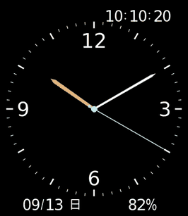

# LUMEN ORBIT

Amazfit Bip 6用watchface **1.9.2**。
アナログ時計に、デジタル時刻・日付・日本語の曜日・電池残量を組み合わせる。

## 必要な環境

- Amazfit Bip 6と、Zeppで時計に接続したスマートフォン。
- Windows x64のPC。
- PCとスマートフォンの両方で接続したTailscale。
- Zeppの開発者モード。

初回設定・詳しい操作・接続できない場合は [導入ツールの手順](zpk-link/README.txt) を参照。

## ダウンロード・導入

GitHub Releasesで公開予定。同じwatchfaceリリースのAssetsから次の2ファイルを取得する。

| ファイル | 用途 |
| --- | --- |
| `lumen-orbit-bip6.zpk` | 時計へ導入するwatchface |
| `zpk-link-windows.zip` | ZPK配信用ツール ZPK LINK 1.0.6（Windows） |

1. Windows導入ツールのZIPを展開する。
2. watchfaceのZPKを `zpk-link.exe` にドラッグ＆ドロップする。
3. PCに表示されたQRを、スマートフォンのZeppの開発者モードで読み取る。
4. Zeppと時計で転送完了を確認し、PC画面の「終了」を押す。

## 改変・ビルド

- [watchfaceのビルド](watchface/README.md)
- [ZPKの最適化](optimization/README.md)
- [導入ツールのテスト・再ビルド](zpk-link/README.txt)
- [開発方針・配布手順](AGENTS.md)

ソースZIPと最適化用ZIPもReleasesに添付する。

## ライセンス

自作コード・watchface画像は [MIT License](LICENSE) で公開する。
第三者コードには、それぞれのライセンスが適用される。

- [QRコードライブラリ](zpk-link/QR-LICENSE.txt)
- [Goランタイム](zpk-link/GO-LICENSE.txt)
